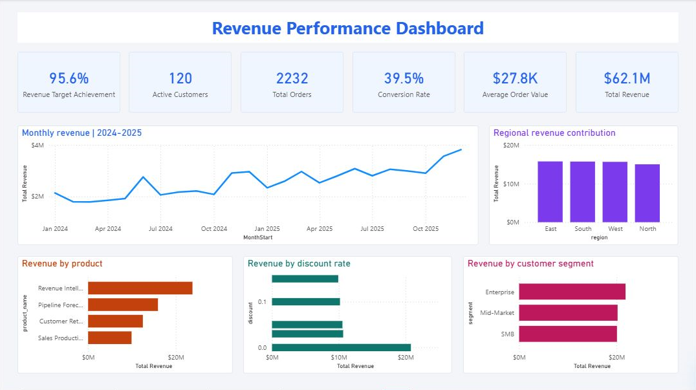
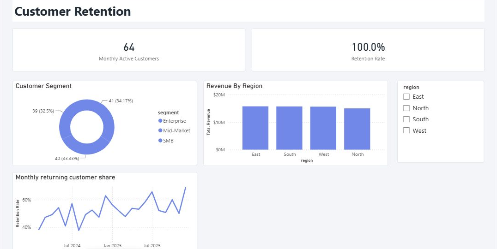
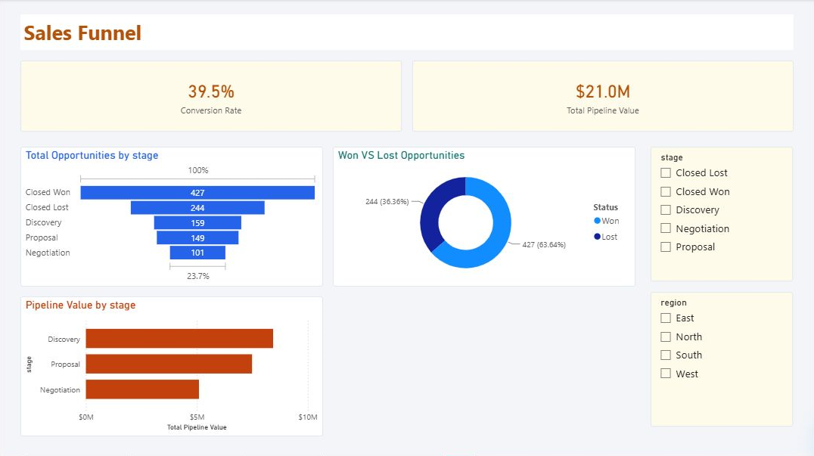
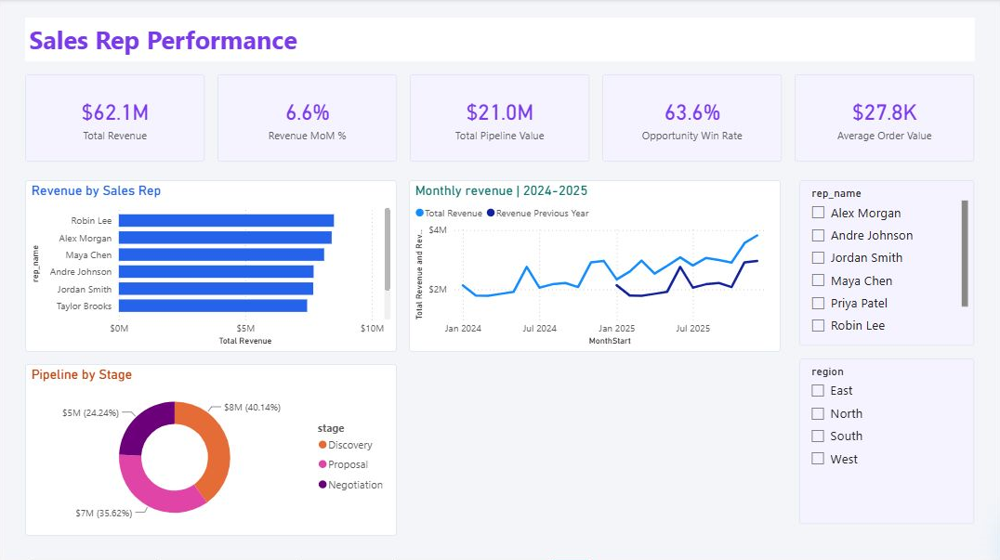

# Revenue Performance Dashboard

Power BI portfolio project exploring revenue performance, customer retention, sales pipeline, and sales representative contribution. Four report pages use a consistent KPI strip, aligned chart grid, and dedicated filter area.

**Power BI | DAX | PostgreSQL | Sales analytics**

## Expanded Demonstration Dataset

The report contains **2,232 orders, 120 customers, eight sales representatives, 1,080 opportunities and 3,240 activities** across January 2024 to December 2025. All records are synthetic portfolio data, not actual business results. Run `python advance_project.py` to reproduce the embedded tables and SQL seed data.

Monthly revenue charts show seasonality across 24 months. The executive page also compares revenue by product and customer segment. Pipeline measures exclude closed opportunities; lost deals count only Closed Lost records. The $65 million revenue target is a demonstration assumption for the full dataset, not an approved business budget.

The retention metric represents the share of customers in the selected period who also ordered in the preceding shifted period. At monthly grain this is returning-customer share, not cohort retention. Monthly Active Customers averages the distinct customer count over selected months. Trend visuals use the connected date table and order-level measures so customer and rep filters apply.

After regenerating data with `python advance_project.py`, run `python refine_report.py` to restore the final presentation and filter-aware trend queries. The executive page includes monthly revenue, regional contribution, product rankings, discount analysis and customer segment comparisons.

The expanded dataset was refreshed successfully in Power BI Desktop. The stage-filter correction was visually verified: pipeline charts display Discovery, Proposal and Negotiation separately and exclude closed opportunities.

The editable report uses embedded demonstration data. PostgreSQL scripts are included separately for reviewing the database design. GitHub displays static images; open the complete PBIP project in Power BI Desktop to interact with the report.

## Project Contents

- `Power BI Project.pbip` - editable Power BI Project file.
- `Power BI Project.Report/` - report page and visual definitions.
- `Power BI Project.SemanticModel/` - semantic model, relationships, tables, and DAX measures.
- `SQL/` - PostgreSQL setup scripts for tables, sample data, and reporting views.
- `screenshots/` - dashboard page previews for GitHub and recruiter review.
- `PROJECT_SKILLS.md` - portfolio summary for recruiters and hiring managers.

## Dashboard Screenshots

Actual Power BI Desktop captures using the expanded synthetic dataset and distinct section colors.

## Dashboard Pages

- Executive Overview
- Customer Retention
- Sales Funnel
- Sales Rep Performance

## Features

- Revenue, orders, active customers, conversion, and average order value KPIs
- Customer retention and monthly active customer analysis
- Opportunity funnel and pipeline tracking
- Advanced DAX measures for MTD, QTD, YTD, MoM, QoQ, and YoY trends
- Sales representative ranking, contribution share, and performance scoring
- Recruiter-friendly PBIP source structure with report and semantic model files
- PostgreSQL schema, seed data, and views included for reproducible setup

## Skills Demonstrated

- Power BI report design and page layout
- DAX KPI development and time intelligence
- Semantic model relationships and measure organization
- PostgreSQL table/view design for analytics reporting
- Sales analytics, retention analysis, and pipeline reporting
- GitHub-ready project packaging and documentation

## How To Review

1. Download the complete repository and open `Power BI Project.pbip` in Power BI Desktop. Keep the Report and SemanticModel folders beside it.
2. Review the four report pages and the `Revenue_measures` table.
3. Refresh and inspect all four pages in Desktop before publishing to your Power BI workspace.
4. Read `PROJECT_SKILLS.md` for a concise portfolio explanation.

## PostgreSQL Setup

Run the SQL scripts in order if you want to recreate the source database:

1. `SQL/01_create_tables.sql`
2. `SQL/02_insert_sample_data.sql`
3. `SQL/03_create_views.sql`

## Tools

- Power BI Desktop
- DAX
- PostgreSQL
- Power BI JSON themes
- Git/GitHub
